# 声架 shelf

<p align="center">
  <a href="https://github.com/Subject2019/shelf/releases/latest"></a>
  <a href="https://github.com/users/Subject2019/packages/container/shelf"></a>
  
  
  <a href="https://github.com/Subject2019/shelf/stargazers"></a>
</p>

> 自托管有声书服务器 · 原 EchoShelf · 声架

在 NAS 上用 Docker 跑一个容器，用浏览器、安卓 App 或飞牛客户端听书，进度多端互通。轻量、单容器、SQLite，不需要 Postgres / Redis。

> **项目已开源**：源码托管在 [Subject2019/shelf](https://github.com/Subject2019/shelf)。Docker 一键部署仓库见 [Subject2019/shelf-docker](https://github.com/Subject2019/shelf-docker)。
>
> **开发说明**：本项目由 **subject** 与 AI 共同开发。需求定义、验收与部署由 subject 负责，代码、文档与测试在 AI 辅助下完成；使用前请自行评估与测试。

---

## 目录

- [简介](#简介)
- [在线实例](#在线实例)
- [界面预览](#界面预览)
- [功能特性](#功能特性)
- [技术栈](#技术栈)
- [架构概览](#架构概览)
- [下载与安装](#下载与安装)
- [配置项](#配置项)
- [数据与目录](#数据与目录)
- [API](#api)
- [项目结构](#项目结构)
- [文档](#文档)
- [常见问题](#常见问题)
- [路线图](#路线图)
- [参与贡献](#参与贡献)
- [许可证](#许可证)

## 简介

shelf 是一个面向 NAS 的自托管有声书服务器。把有声书目录挂载进容器，shelf 会自动扫描、识别标签 / 章节 / CUE、提取封面并入库；网页端提供完整的播放器，支持多端进度同步；同一套 WebUI 也可作为 Android 壳使用（WebView 负责界面，原生 Media3 负责后台播放与状态栏/锁屏控制）。

设计目标是 **单容器 + SQLite** 的轻量部署：无需额外的数据库或消息队列，一台普通 NAS 即可承载大规模文件索引与多路并发播放。

## 在线实例

- 实例地址：http://123.56.254.152
- 用户名：`shelf`
- 密码：`shelf2026`

> 公开演示账号，仅供体验；请勿存放隐私数据。

## 界面预览

> 截图来自开发环境（demo 账号 + 示例书库），暗色主题。

### 桌面端（1440×900）

<p align="center">
  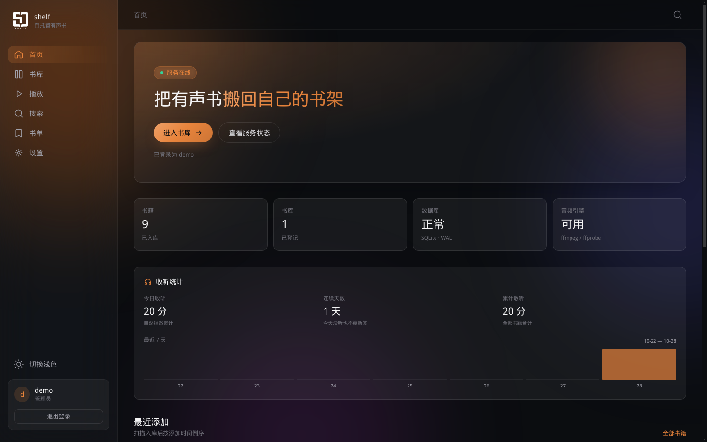
  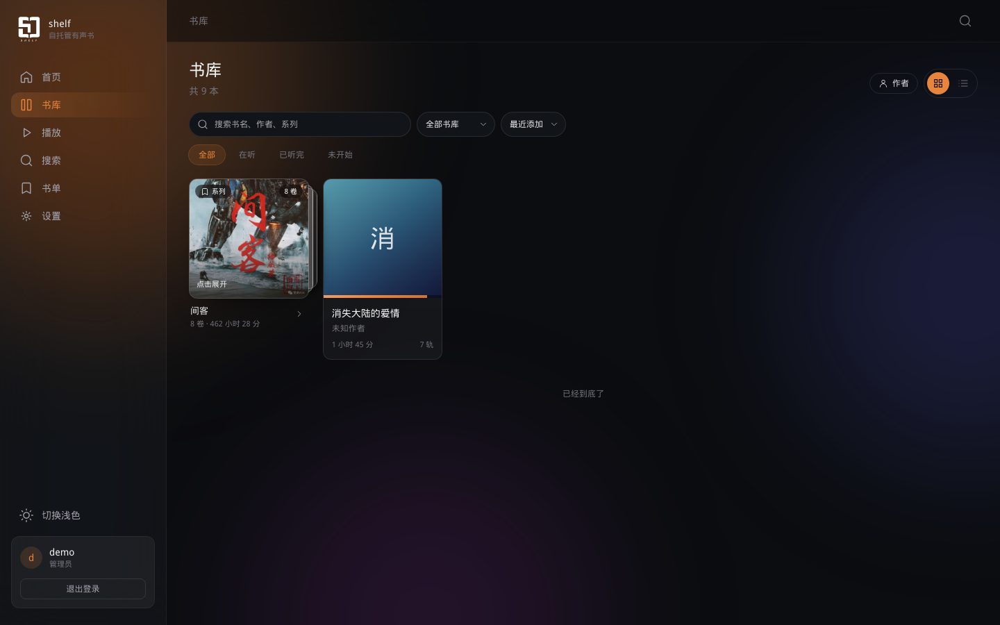
</p>
<p align="center">
  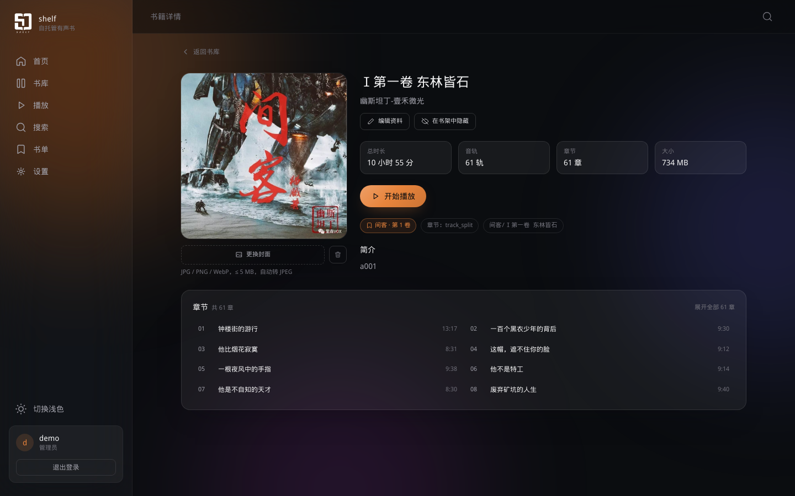
  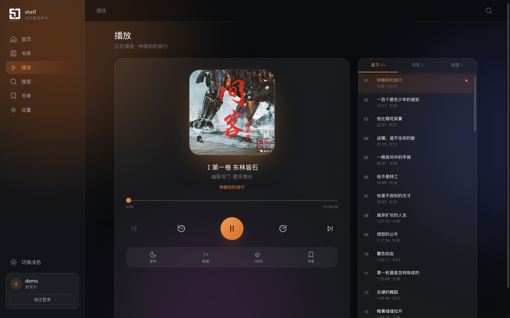
</p>
<p align="center">
  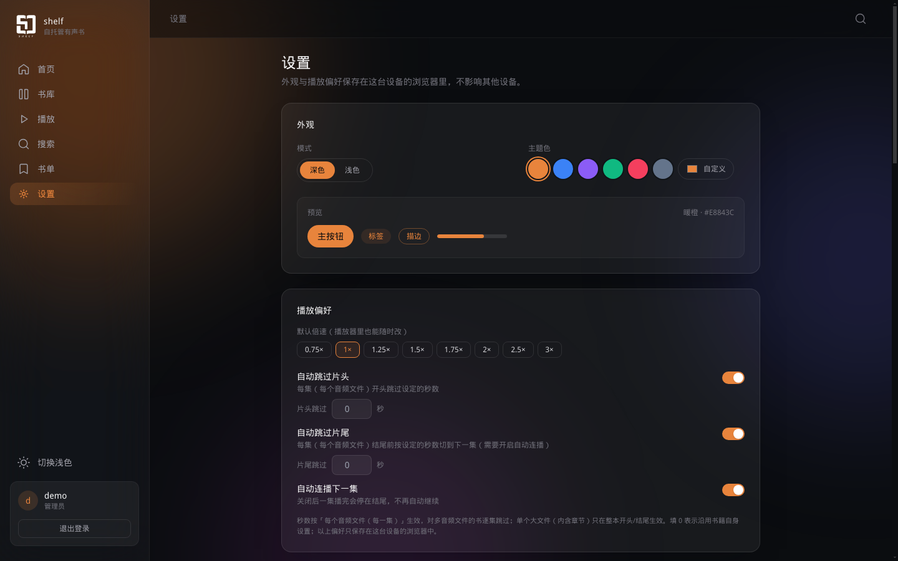
  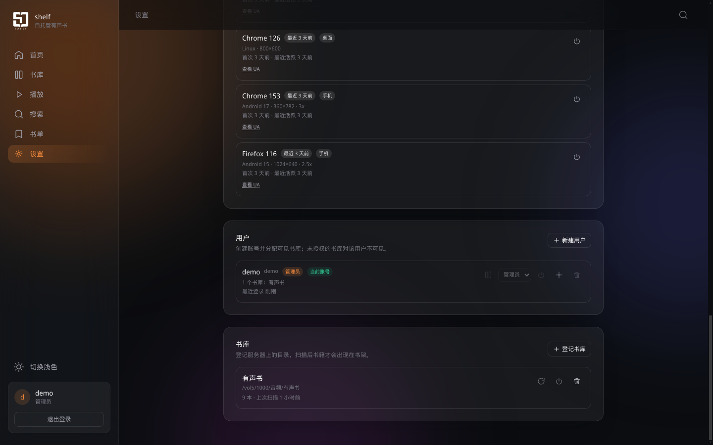
</p>
<p align="center">
  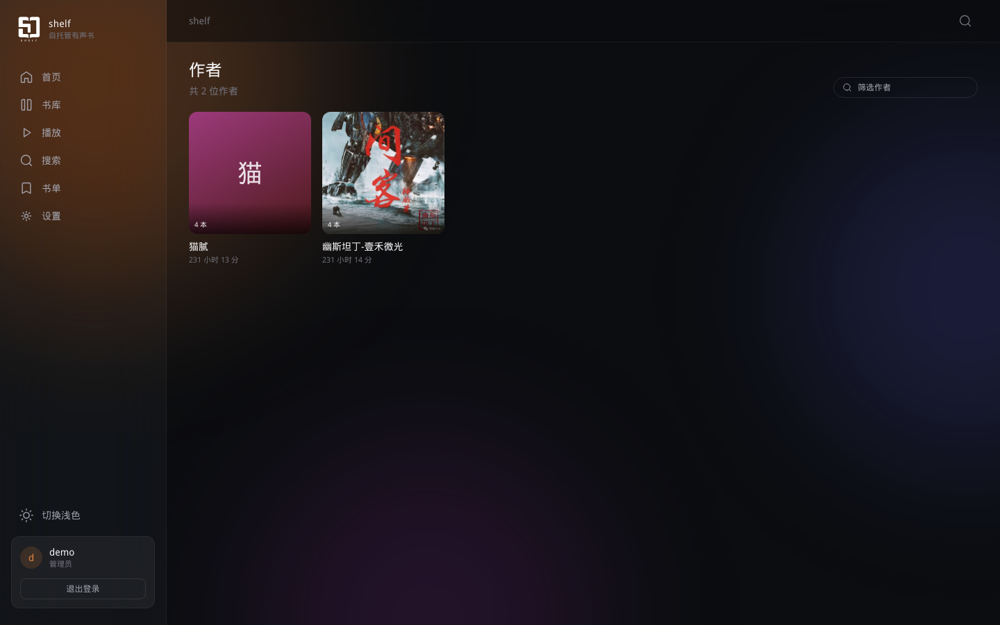
</p>

### 手机端（390×844）

<p align="center">
  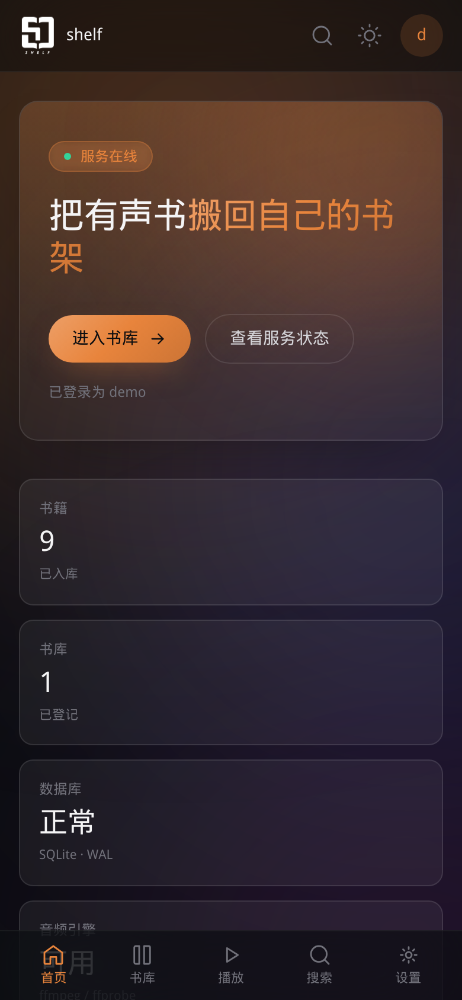
  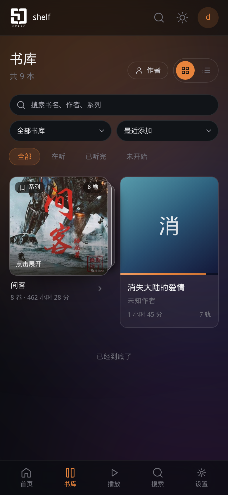
  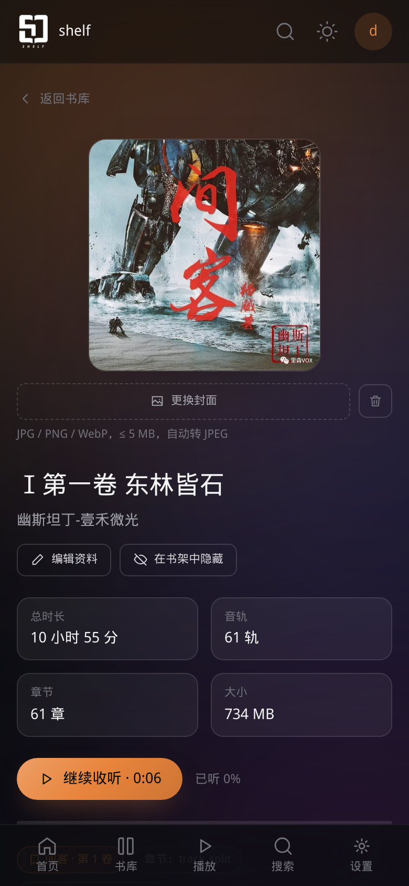
</p>
<p align="center">
  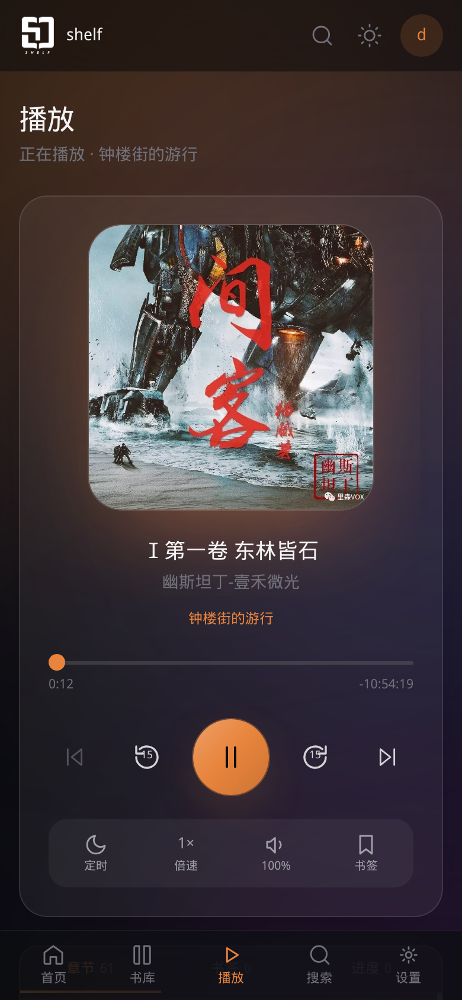
  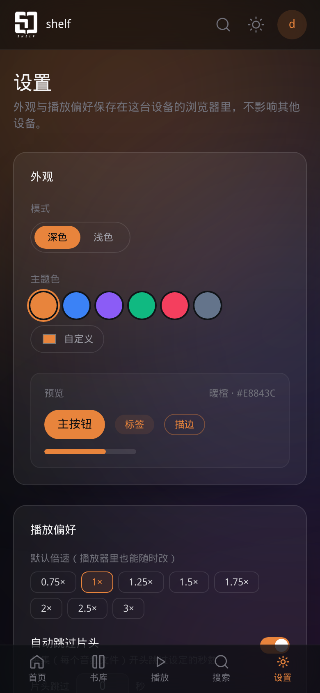
</p>

## 功能特性

### 书库与扫描

- 登记服务器目录，递归扫描音频文件，自动识别标题 / 作者 / 演播者 / 系列等标签
- 支持 CUE 分轨、内嵌章节、封面提取
- 重扫幂等，不会产生重复书籍；缺失文件标记、隐藏书籍
- 按书库授权，未授权用户不可见

### 播放

- 全局播放器：切换路由不断音，底部播放条 + 全屏播放页
- 倍速、上一章 / 下一章、±15 秒、音量、静音
- 章节列表、书签、进度回溯点（每本书保留多个检查点）
- 睡眠定时（按时长 / 按集数，最后 30 秒淡出）
- 自动连播；跳过片头 / 片尾（按每个音频文件 / 每集生效）
- 多端进度同步：同一账号在网页 / 手机上共享进度

### 格式与转码

- 直接流式播放：mp3 / m4a / m4b / aac / flac / ogg / opus / wav
- 浏览器不支持的格式（wma / ape 等）由服务端 ffmpeg 转码为 opus / mp3
- 支持 HTTP Range，大文件拖动不整段传输

### 检索与统计

- FTS5 全文搜索（书名 / 副标题 / 作者 / 演播者 / 系列 / 简介），中文短词回退 LIKE
- 作者视图、系列分组
- 个人书单：自定义专题 / 待听清单，详情页一键加入或移出
- 收听统计：今日 / 累计 / 连续天数 / 近 7 天

### 多用户与安全

- 三级角色：管理员 / 上传者 / 听众
- 书库级授权（未授权用户不可见）
- 设备管理、密码修改、refresh token 吊销
- 管理员只能带外创建（环境变量或 CLI），网页端不提供初始化入口

### 客户端

- WebUI 响应式布局，浏览器直接使用（未内置 service worker，暂不等同完整 PWA）
- Android 壳（`android-pwa/`，包名 `com.shelf.pwa`，当前 0.2.9）：WebView 复用 WebUI，原生 Media3 负责后台播放；状态栏/锁屏提供上一集、快退 15 秒、播放/暂停、快进 15 秒、下一集、封面和当前单集进度条；进度由原生服务每 15 秒直报，划掉后台也会继续同步
- 原生播放依赖服务端 WebUI 中的 `ShelfPlayer` 适配层；升级 APK 或前端后请保持两端一致，否则会回退到 WebView `<audio>`，状态栏不显示媒体卡片
- 原生 Compose 版（`android/`）为早期实验，已搁置；其 Media3 播放服务已被 WebView 壳复用

## 技术栈

| 层 | 选型 |
|---|---|
| 后端 | Python 3.11+ · FastAPI · SQLAlchemy 2.0 · Alembic · SQLite（WAL / FTS5）· mutagen · ffmpeg |
| 网页端 | React 18 · TypeScript · Vite · TailwindCSS · Zustand · TanStack Query |
| 移动端 | Android WebView 壳 + 原生 Media3 播放（`android-pwa/`） |
| 部署 | Docker 多阶段构建（单镜像含前端静态资源）· docker compose · systemd |

## 架构概览

- **单体优先**：一个 FastAPI 进程 + SQLite；后台扫描任务在进程内调度。
- **直出优先，转码兜底**：支持 Range 的原文件直接流式传输；客户端不支持时才走 ffmpeg。
- **元数据以文件为准**：数据库只做索引缓存，删库可重建，扫描幂等。
- **进度以客户端为准，服务端仲裁**：多端冲突按「最后写入胜 + 单调不回退」合并。

更完整的架构与数据流见 [`docs/ARCHITECTURE.md`](./docs/ARCHITECTURE.md)。

## 下载与安装

三种安装形态，按你的设备选择：

| 安装包 | 适用场景 | 获取方式 |
|---|---|---|
| **Android APK** | 手机上听书，连接已有 shelf 服务端 | [下载 `shelf-0.2.9.apk`](https://github.com/Subject2019/shelf/releases/download/v0.2.9/shelf-0.2.9.apk) |
| **飞牛 fnOS fpk** | 飞牛 NAS 一键安装，包含服务端 | [下载 `shelf-0.2.9-fnos.fpk`](https://github.com/Subject2019/shelf/releases/download/v0.2.9/shelf-0.2.9-fnos.fpk) |
| **Docker 镜像** | 群晖 / 威联通 / Unraid / Linux 等 | `ghcr.io/subject2019/shelf:0.2.9`，见下方 Docker 章节 |

> Android APK 只是客户端，需要连接一个正在运行的 shelf 服务端；飞牛 fpk 和 Docker 镜像都包含服务端。
>
> 一键部署 / 升级 / 卸载脚本和 compose 配置在 [Subject2019/shelf-docker](https://github.com/Subject2019/shelf-docker)。
>
> 容器镜像页面：[ghcr.io/subject2019/shelf](https://github.com/users/Subject2019/packages/container/shelf)。

### Docker 镜像（服务端）

#### 一键部署（推荐）

```bash
git clone --depth 1 https://github.com/Subject2019/shelf-docker.git
cd shelf-docker
bash install.sh
```

安装脚本会询问媒体目录、数据目录、管理员账号和端口，并自动生成 `.env`、启动容器。

#### 直接运行

```bash
docker run -d --name shelf \
  -p 8080:8080 \
  -v /path/to/audiobooks:/audiobooks:ro \
  -v /path/to/data:/data \
  -e ECHOSHELF_ADMIN_USERNAME=admin \
  -e ECHOSHELF_ADMIN_PASSWORD='change-me-please' \
  -e PUID=1000 -e PGID=1000 \
  ghcr.io/subject2019/shelf:latest
```

打开 `http://<NAS_IP>:8080`，用上面的管理员账号登录。

> 数据目录必须放在本地盘，不要用 SMB / NFS；媒体目录以只读方式挂载。

#### 使用 docker compose

```yaml
services:
  shelf:
    image: ghcr.io/subject2019/shelf:latest
    container_name: shelf
    restart: unless-stopped
    ports:
      - "8080:8080"
    environment:
      ECHOSHELF_ADMIN_USERNAME: admin
      ECHOSHELF_ADMIN_PASSWORD: change-me-please
      PUID: 1000
      PGID: 1000
    volumes:
      - /path/to/audiobooks:/audiobooks:ro
      - /path/to/data:/data
```

```bash
docker compose up -d
```

### 本地开发

```bash
# 后端
cd backend
python3 -m venv .venv && . .venv/bin/activate
pip install -r requirements.txt
uvicorn app.main:app --reload --port 8080

# 前端（另开终端）
cd web
npm ci
npm run dev        # http://localhost:5173 ，/api 代理到 127.0.0.1:8080
```

默认数据目录为仓库根 `data/`，可通过 `ECHOSHELF_DATA_PATH` 覆盖。

### 构建镜像

```bash
docker build -f deploy/docker/Dockerfile -t shelf:latest .
```

### Android 客户端（android-pwa）

<p>
  <a href="https://github.com/Subject2019/shelf/releases/download/v0.2.9/shelf-0.2.9.apk"></a>
</p>

WebView 壳不内置网页：启动后从服务器加载 WebUI，音频播放由原生 Media3 前台服务接管。完整说明见 [`android-pwa/README.md`](./android-pwa/README.md)。

**构建**

```bash
cd android-pwa
./gradlew assembleRelease
# 产物：app/build/outputs/apk/release/app-release.apk
```

需要 JDK 17+ 与 Android SDK 35；首次构建会下载 Gradle 8.7、AGP 和 Media3 1.3.1。release 签名使用本地 `android-pwa/keystore.properties` 与 `release.keystore`（不提交），请备份密钥。

**安装与连接**

1. 安装 APK（允许未知来源）。
2. 首次启动填写 shelf 地址，例如 `http://<NAS_IP>:8080`；开发环境可填 Vite 地址 `http://<开发机_IP>:5173`。
3. Android 13+ 首次启动会申请通知权限，必须允许，否则状态栏/锁屏没有媒体卡片。
4. 长按页面可随时「更改服务器」。

**通知与播放**

- 按钮顺序：上一集、快退 15 秒、播放/暂停、快进 15 秒、下一集；全部以标准播放器动作提交，具体间距由手机系统媒体卡片决定。
- 封面由网页抓取后以字节写入 `MediaMetadata`，不依赖系统加载远程封面。
- 对系统暴露当前音轨的真实时长和当前项 seek 命令，因此状态栏/锁屏媒体卡片会显示可拖动的单集进度条；具体样式和位置由 ROM 决定。
- 系统媒体卡片不支持音量滑杆，音量使用 App 内音量条或手机音量键。

> **前端必须同步更新**：壳只提供原生桥，网页不调用 `ShelfPlayer` 时仍走 WebView `<audio>`。生产环境更新 APK 后，需要重新构建并部署 `web/`（Docker 镜像或静态 `dist`）。

### 飞牛 fnOS（fpk）

<p>
  <a href="https://github.com/Subject2019/shelf/releases/download/v0.2.9/shelf-0.2.9-fnos.fpk"></a>
</p>

`fpk` 是飞牛 NAS 的应用安装包，内置服务端镜像，不要求用户自己写 Compose。

安装步骤：

1. 在飞牛应用中心选择「手动安装」，上传 `shelf-0.2.9-fnos.fpk`；
2. 安装向导填写访问端口、管理员账号密码和是否启用转码；
3. 有声书目录可留空使用共享目录 `shelf/media`，也可以填写飞牛上的已有目录；
4. 安装完成后从桌面「声架」入口打开，进入「设置 → 书库」确认路径为容器内 `/audiobooks`。

详细说明、目录结构和构建方式见 [`fnos/README.md`](./fnos/README.md)。

## 配置项

宿主机 `.env`（compose）/ 容器环境变量：

| 变量 | 默认 | 说明 |
|---|---|---|
| `AUDIOBOOKS_PATH` | `/volume1/media/audiobooks` | 宿主机媒体目录，挂载到容器 `/audiobooks:ro` |
| `ECHOSHELF_DATA_PATH` | `/volume1/docker/shelf` | 数据目录（数据库 / 封面缓存），必须本地盘 |
| `SHELF_HOST_PORT` | `8080` | 宿主机映射端口（容器内固定 8080） |
| `ECHOSHELF_ADMIN_USERNAME` | `admin` | 管理员用户名 |
| `ECHOSHELF_ADMIN_PASSWORD` | — | 管理员密码（建议 ≥8 位）；也可用 `_FILE` 指向 secret 文件 |
| `ECHOSHELF_ADMIN_SYNC_PASSWORD` | `false` | 每次启动用上面的密码覆盖管理员密码 |
| `ECHOSHELF_ALLOW_REGISTRATION` | `false` | 是否允许网页注册 |
| `ECHOSHELF_ENABLE_TRANSCODE` | `true` | 是否启用 ffmpeg 转码 |
| `PUID` / `PGID` | `1000` | 容器运行身份，需对媒体目录有读权限 |
| `TZ` | `Asia/Shanghai` | 时区 |
| `ECHOSHELF_LOG_LEVEL` | `info` | 日志级别 |

> **权限提示**：容器以 `PUID/PGID` 运行，媒体目录必须对该用户可读（例如 `sudo chmod -R a+rX /path/to/audiobooks`），否则扫描会读不到文件。

## 数据与目录

| 容器路径 | 用途 |
|---|---|
| `/audiobooks` | 媒体目录（只读挂载） |
| `/data` | 数据库、封面缓存、日志等运行数据 |

数据库使用 SQLite WAL + FTS5；容器启动时自动执行 `alembic upgrade head`（幂等）。

## API

后端为 FastAPI，接口前缀 `/api/v1`，自动生成 OpenAPI 文档：

- Swagger UI：`http://<host>:8080/api/docs`
- OpenAPI JSON：`http://<host>:8080/api/openapi.json`

完整接口参考见 [`docs/API.md`](./docs/API.md)。

## 项目结构

```
shelf/
├── backend/                 FastAPI 服务（app/ + alembic/ + tests/）
├── web/                     React 网页端（Vite）
├── android-pwa/             Android WebView 壳 + 原生 Media3 播放
│   ├── app/src/main/java/com/shelf/pwa/           壳、设置页与 JS 桥
│   ├── app/src/main/java/com/shelf/pwa/player/    Media3 服务 / 控制器
│   └── README.md                                  构建、连接与通知说明
├── android/                 原生 Compose 版（实验，已搁置）
├── fnos/                    飞牛 fnOS 应用工程（fpk / Compose / 安装向导）
├── deploy/
│   ├── docker/              Dockerfile / entrypoint / compose
│   ├── bare/                systemd 常规部署
│   ├── scripts/             backup / restore / healthcheck
│   └── shelf-docker/        公开部署仓库（独立 git 仓库）
├── docs/                    架构 / 接口 / 数据模型 / 部署文档
├── data/                    运行时数据（git 忽略）
├── release/                 发布产物（git 忽略）
└── README.md
```

## 文档

| 文档 | 内容 |
|---|---|
| [docs/ARCHITECTURE.md](./docs/ARCHITECTURE.md) | 系统架构与关键流程 |
| [docs/API.md](./docs/API.md) | 接口参考（权限 / 示例 / 错误码） |
| [docs/DATA_MODEL.md](./docs/DATA_MODEL.md) | 数据库表结构 |
| [docs/AUDIO_FORMATS.md](./docs/AUDIO_FORMATS.md) | 音频格式 / 章节 / CUE 支持矩阵 |
| [docs/CLIENT_DOWNLOAD.md](./docs/CLIENT_DOWNLOAD.md) | 客户端按章节下载约定 |
| [android-pwa/README.md](./android-pwa/README.md) | Android 壳构建、连接与通知说明 |
| [fnos/README.md](./fnos/README.md) | 飞牛 fnOS 应用包构建、安装与目录说明 |
| [docs/DEPLOY_NAS.md](./docs/DEPLOY_NAS.md) | NAS 部署与运维 |
| [Subject2019/shelf-docker](https://github.com/Subject2019/shelf-docker) | 公开 Docker 部署仓库 / 一键脚本 / APK Release |
| [docs/ROADMAP.md](./docs/ROADMAP.md) | 里程碑与任务拆解 |
| [docs/ADR/](./docs/ADR/) | 架构决策记录 |

## 常见问题

**扫描后书是 0 本？**
先确认媒体目录已挂载到 `/audiobooks`，且容器用户（PUID/PGID）可读。可在「设置 → 书库」重新登记 / 扫描。

**浏览器无法播放 wma / ape？**
属于预期：这两类由服务端转码为 opus / mp3 输出，首次播放会有转码延迟。

**修改管理员密码后重启被覆盖？**
若设置了 `ECHOSHELF_ADMIN_SYNC_PASSWORD=true`，每次启动都会用环境变量覆盖；改密码请改环境变量或关闭该开关。

**忘记管理员密码？**
修改 `ECHOSHELF_ADMIN_PASSWORD` 并重启（或开启同步开关）；也可进入容器执行 CLI 重置。

**Android 状态栏/锁屏没有播放控件或封面？**
先确认系统通知权限已允许（Android 13+），并确认 App 连接的是包含 `ShelfPlayer` 适配层的新前端（开发环境 5173，或已重建的生产镜像）。只更新 APK、服务端仍是旧 `web/dist` 时，网页不会调用原生桥，仍走 WebView `<audio>`。

**Android 桌面图标被裁切/只显示一小块？**
自适应图标前景已限制在安全区；如果仍是旧图标，卸载重装，或重启启动器/清除启动器缓存，因为启动器会缓存图标资源。

**Android 通知按钮间距和预期不一致？**
按钮顺序由 App 固定为上一集、快退、播放/暂停、快进、下一集；进度条已对系统暴露，具体间距、分组和进度条样式由手机 ROM 的系统媒体卡片决定，部分 ROM 可能无法完全等分。

**Android 划掉后台后进度少一段？**
确认使用 0.2.9+ APK，并且服务端 `web/dist` 已更新：网页需要把 `bookId/baseUrl/token/deviceId` 注入原生服务，旧前端不会触发原生直报。可用 `adb logcat -s ShelfProgress` 查看上报结果；如果是 HTTP 401，等网页刷新 token 后会自动补传。

## 路线图

Web 端与 Android 壳的核心链路已完成（Android 壳 0.2.9）；后续主要是发布、兼容性打磨与离线能力。详见 [`docs/ROADMAP.md`](./docs/ROADMAP.md)。

## 参与贡献

欢迎提交 Issue 和 Pull Request：

- 使用问题、功能建议：优先到 [Issues](https://github.com/Subject2019/shelf/issues) 搜索或新建；
- 提交代码前，后端运行 `cd backend && .venv/bin/python -m pytest -q`；
- 前端运行 `cd web && npm run build`，确保 TypeScript 和 Vite 构建通过；
- Android 修改后运行 `cd android-pwa && ./gradlew assembleRelease`；
- 不要提交数据库、媒体文件、`secret.key`、签名密钥或真实环境配置。

如果这个项目对你有帮助，欢迎给主项目点一个 Star。

## 许可证

- 作者：**subject**
- 开发：**subject** 与 AI 共同开发
- 版权：Copyright © 2026 subject
- 源码：<https://github.com/Subject2019/shelf>

当前仓库尚未附带正式的开源 `LICENSE` 文件。在补充许可证之前，源码虽已公开，但默认保留所有权利；如需复制、修改、分发或商用，请先联系作者确认授权。
